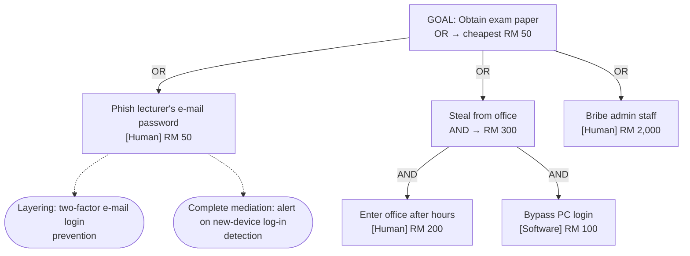
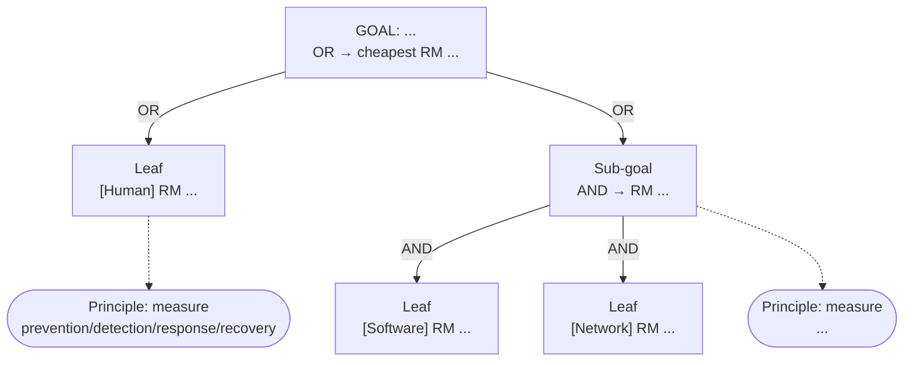

**Slides:** 43–50 · **Format:** breakout group, ONE comment per group

**Goal:** *Obtain the final exam paper before the exam* (or the attacker's goal from your M2 incident).

**Rules**
1. At least 2 levels with **AND** and **OR** nodes, and at least 5 leaves.
2. Tag each leaf with its attack surface (**Network / Software / Human**) and an estimated attacker cost in **RM**.
3. Work out the cheapest path: an **OR** node takes its cheapest child, and an **AND** node takes the sum of its children.
4. Propose **2 countermeasures** on the cheapest path. Name each one's **design principle** (Slides 40–41) and say whether it is **prevention, detection, response or recovery** (Slide 50).

**Worked example.** GitHub draws Mermaid diagrams, so this is how your comment will look:



**Reply template** (copy everything, including the ```` ```mermaid ```` lines):

````
Group:



New cheapest path after countermeasures + cost:
````

**Discussion:** after your countermeasures, which path becomes the cheapest, and by how much did the attacker's cost rise? Reply to one other group.
